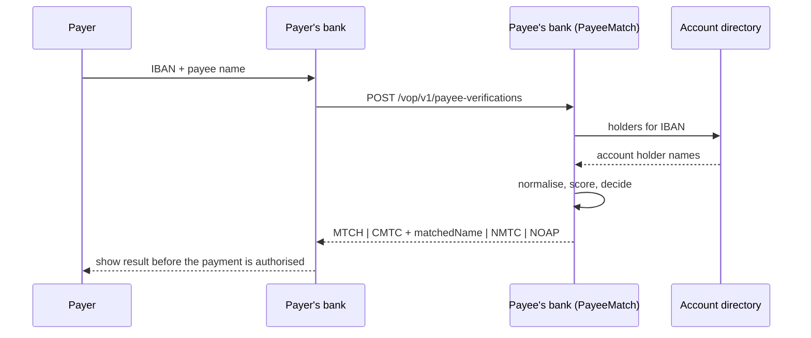

# PayeeMatch

[](https://github.com/softvasco/payee-match/actions/workflows/ci.yml)
[](LICENSE)

Verification of Payee name matching for .NET, following the EPC VOP scheme. You give it the name the payer typed and the account holder names behind an IBAN. It answers match, close match or no match, and tells you why.

Work in progress. The matching core comes first, then the EPC responder API.

## Why

Since 9 October 2025 the EU Instant Payments Regulation requires every payment provider to check the payee name against the IBAN before a credit transfer. The EPC scheme defines the API between banks, but for the matching itself it only gives guidelines. Every bank ended up building or buying its own matcher, and I couldn't find an open one.

The interesting part is the name matching. "Joao M. Silva" and "João Manuel da Silva" should be a close match. "Silva Lda" against "Silva, Unipessoal Lda" probably too. "Silva Construções SA" against "Silva Consultores SA" should not. And a bank has to be able to explain each of those answers to an auditor.

## How a check flows



## Outcomes

| Code | Meaning | Returned name |
|---|---|---|
| MTCH | Match | no |
| CMTC | Close match | yes, the holder's name, so the payer can check |
| NMTC | No match | no |
| NOAP | Check not possible | no |

## What works so far

The core library normalises names (accents, case, punctuation, titles and legal forms), scores strings with Jaro-Winkler and Damerau-Levenshtein, and compares names word by word. The token matcher pairs words in any order, lets an initial stand for a word, and charges less for a middle name only one side has than for a word that contradicts the other side:

| Payer typed | Account holder | Token score |
|---|---|---|
| J. M. Silva | Joao Manuel Silva | 0.867 |
| Joao Silva | Joao Manuel Silva | 0.870 |
| Maria Silva | Joao Silva | 0.500 |
| J. M. S. | Joao Manuel Silva | 0 (initials alone never match) |

`DecisionEngine` turns that into an outcome. A score of 0.95 or more is MTCH, 0.80 or more is CMTC, anything lower is NMTC, and each decision lists the reason codes that applied:

| Payer typed | Account holder | Outcome | Reasons |
|---|---|---|---|
| DR. JOÃO SILVA | Joao Silva | MTCH | SameNameAfterNormalisation |
| Silva Joao | Joao Silva | MTCH | WordOrderDiffers |
| J. M. Silva | Joao Manuel Silva | CMTC | InitialUsed |
| Joao Silva | Joao Manuel Silva | CMTC | WordsMissing |
| Joao Santos | Joao Silva | NMTC | WordsDiffer |
| J. M. S. | Joao Manuel Silva | NMTC | NoWordInCommon |

The thresholds are the bank's call, not mine. A bank that wants every typo confirmed by the payer sets the match threshold to 1, and "Joao Silvva" becomes CMTC with `SpellingDiffers`:

```csharp
var engine = new DecisionEngine(new MatchThresholds(match: 1, closeMatch: 0.8));
var decision = engine.Decide("Joao Silvva", "Joao Silva");
// CloseMatch, [SpellingDiffers], decision.Outcome.ToEpcCode() == "CMTC"
```

A legal form left out still matches, since payers often drop it. Two different ones are another matter: "Acme Lda" and "Acme SA" are usually two companies, so the best they get is CMTC with `LegalFormDiffers`. A name with a legal form on either side is treated as a company, and a typo there is CMTC too: "Padaria Centrall Lda" against "Padaria Central Lda" could be another brand, so the payer should see the name.

## Plan

- Name normaliser: diacritics, case, punctuation, titles and legal forms per country.
- Similarity: Jaro-Winkler and Damerau-Levenshtein, plus token rules for word order, initials and missing middle names.
- Decision engine with configurable thresholds and a reason code on every outcome.
- Different rules for people and companies, joint accounts, and LEI checks for the identification code flow.
- ASP.NET Core responder for the EPC endpoint, with an in-memory and a PostgreSQL account directory.
- A public synthetic evaluation set with precision and recall, and benchmarks.

## Build

```bash
dotnet build
dotnet test
```

Needs the .NET 10 SDK.

## License

MIT
